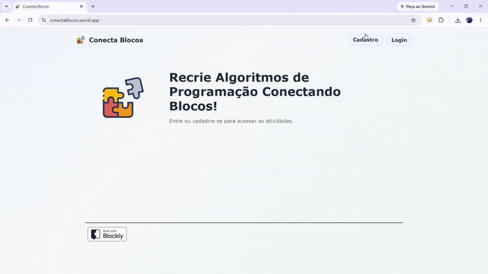

# Projeto final




## Acesso
https://conectablocos.vercel.app/

Como o deploy do backend está no Render, é possível que haja algum atraso na resposta se ele estiver "adormecido". Para resolver isso, é só esperar ou acessá-lo em: [deploy backend](https://conectablocos-giborelli.onrender.com/).

## Desenvolvedor(a)
**Giovana Borelli** - Ciência da Computação

## Proposta
Será continuado o desenvolvimento dos projetos anteriores, mas o desenvolvimento será individual. As novas funcionalidades a serem incluídas serão:
- Login federado;
- Resultados ao rodar as questões mostrados com SweetAlert;
- Criação de turmas (na qual a adição de alunos na turma será feita pelos professores).
Também buscarei realizar testes com usuários. 
Tecnologias: utilizarei as mesmas tecnologias já utilizadas. No back-end: Python (FastAPI); no banco de dados: PostGresSQL (Render); para o front-end: HTML, CSS, JavaScript e Blockly; e para o deploy: Vercel + Render.

## Desenvolvimento

### Processo
Primeiramente, desenvolvi o CRUD completo de todos os objetos que poderiam ser criados, ou seja: contas e questões. Assim, o Professor tem permissão para editar e excluir questões, assim como pode editar e excluir alunos, com total acesso a esses dados até o momento. Além disso, adicionou-se o campo de `blocos_esperados` completo para as questões fechadas serem efetivamente corrigidas, não só o resultado final.

Em segundo lugar, implementou-se os alertas com SweetAlert para diferentes dados. Como, por exemplo, a informação do que o código do estudante rodou e como se compara com a resposta correta e a confirmação com senha para excluir uma conta cadastrada manualmente.

Depois, configurou-se a chave de usuário OAuth para permitir cadastro com Google. O qual houve alguns problemas, principalmente por erro do acesso de link e a impossibilidade de testes locais. Ademais, novamente só foi possível fazer o deploy do projeto no Vercel por meio do terminal Vercel CLI, entrentanto o deploy do backend no Render foi tranquilo de ser realizado.

Por último, organizou-se todos os códigos em arquivos diferentes e menores, para evitar arquivos com mais de 1000 linhas, o que estava complicando refatorações. Além disso, criou-se arquivos de exemplo para permitir que outras pessoas configurem seus próprios projetos, como [config-example.js](/frontend/config-example.js) que demonstra como adicionar o id de cliente google e [abertas.json](/backend/modelos_questoes/abertas.json) que possui modelos para questões abertas.


### Trechos de código
Gostaria de destacar esse primeiro trecho de código, porque está relacionado com as mudanças que foram necessárias para a adição de um CRUD completo para a atualização do usuário e das questões.
```schemas.py
class UsuarioUpdate(BaseModel):
    model_config = ConfigDict(str_strip_whitespace=True)

    nome: str = Field(min_length=1)
    email: EmailStr
    senha: str | None = Field(default=None, min_length=6)


class SenhaConfirmacao(BaseModel):
    senha: str = Field(min_length=1)
```

O segundo trecho de código foi separado para destacar a integração com cadastro do Google. Demonstra-se a seção que verifica se o login do usuário está correto e, se sim, cria token para ele. Além disso, mostra-se o cabeçalho da seção para iniciar com o google, em que é necessário já enviar se o usuário será Professor ou Estudante.

```auth_routes.py
@router.post("/auth/login", response_model=TokenResponse)
async def login_user(data: UsuarioLogin, db: Session = Depends(get_db)):
    user = db.scalar(
        select(Usuario).where(Usuario.email == data.email)
    )
    if (
        user is None
        or not user.has_password
        or not verify_password(data.senha, user.senha_hash)
    ):
        raise HTTPException(status_code=status.HTTP_401_UNAUTHORIZED, detail="E-mail ou senha incorretos.", headers={"WWW-Authenticate": "Bearer"})

    return create_user_token_response(user)


@router.get("/auth/google/start")
async def start_google_auth( tipo_usuario: Literal["professor", "estudante"] | None = None, ):

. . .

```

O terceiro e último trecho está relacionado com os alertas que foram modificados com SweetAlert.

```alerts.js
(function () {
  function alert(options) {
    const config = {
      theme: 'auto',
      confirmButtonText: 'Entendi',
      ...options
    };
    if (!window.Swal) {
      window.alert(config.text || config.title || 'Ocorreu um erro.');
      return Promise.resolve({ isConfirmed: true });
    }
    return window.Swal.fire(config);
  }
  
. . .

  window.AppAlerts = { alert, confirm, requestPassword };
})();  
```

## Tecnologias

### Linguagens e afins
- Back-end: Python (com FastAPI)
- Banco de Dados: PostgreSQL
- Linguagens Front-end: HTML, CSS, JavaScript e Blockly
- Deploy: Vercel (com o terminal Vercel CLI) + Render

### Ambiente de desenvolvimento
- Python 3.11
- Banco de Dados PostgreSQL
- VS Code
- Git e Github
- Github Copilot Chat

## Referências e créditos
- Render Web Services: https://render.com/docs/web-services
- SweetAlert (usage e theme): https://sweetalert2.github.io/#usage
- Configuração da Conexão com OAuth do Google: https://developers.google.com/identity/protocols/oauth2/web-server?hl=pt-br

---
Projeto entregue para a disciplina de [Desenvolvimento de Software para a Web](http://github.com/andreainfufsm/elc1090-2026b) em 2026b